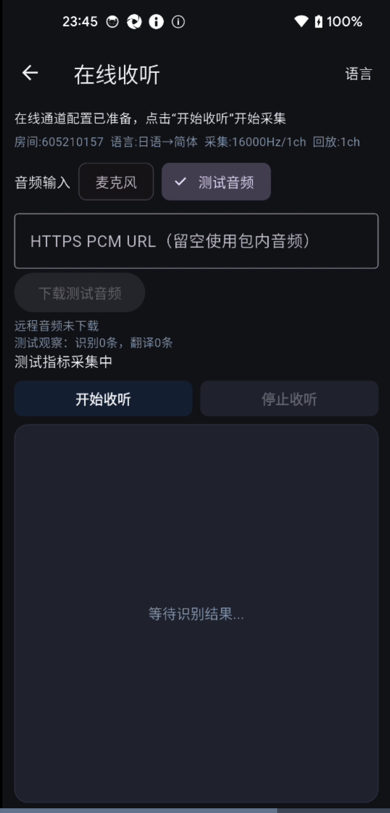
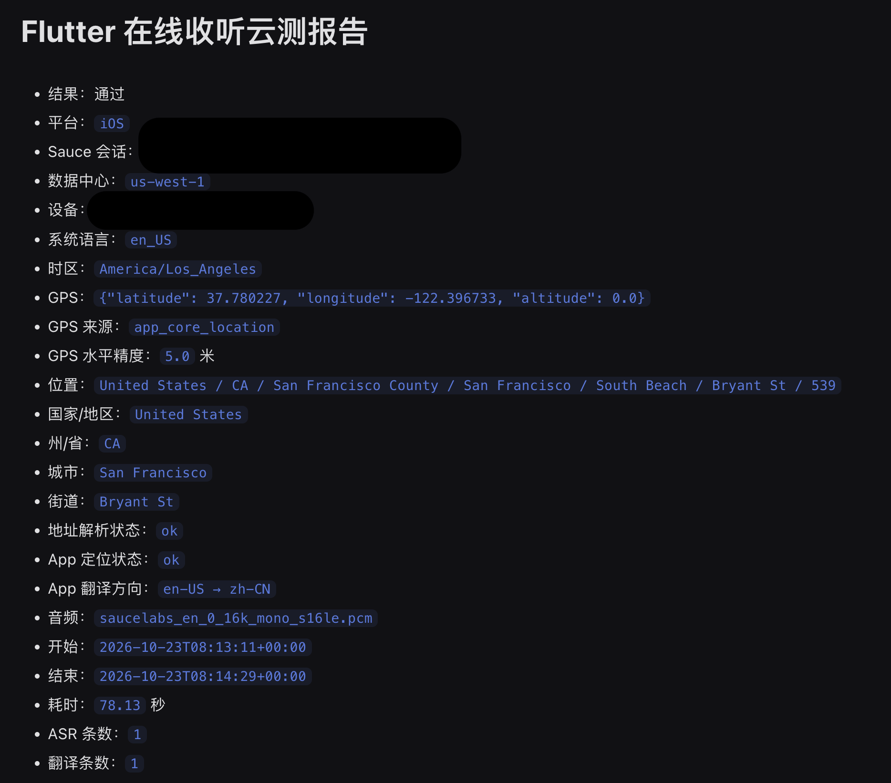
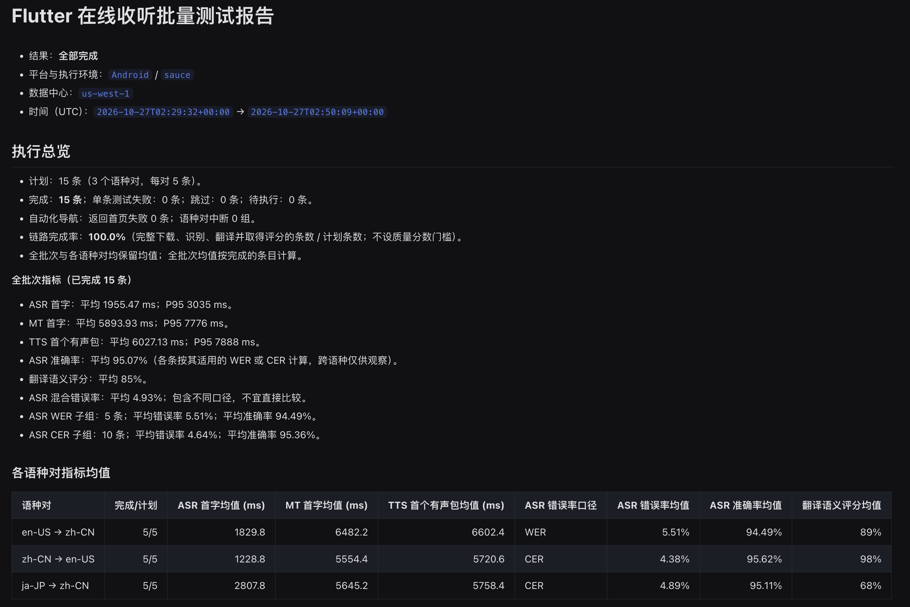
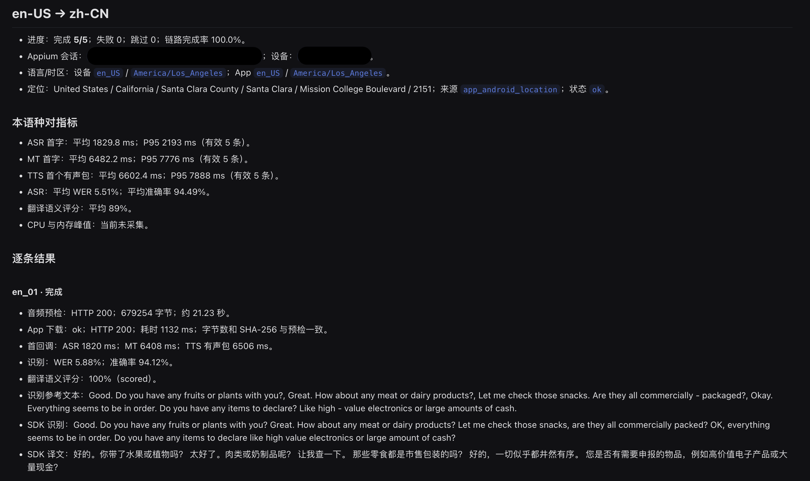

# Flutter 在线收听 Sauce Labs 真机测试

这个测试运行 Flutter Sample 的「收听模式 → 在线翻译」。默认音频输入是麦克风；选择「测试音频」后，**URL 留空**时 App 读取安装包内的 `saucelabs_en_0_16k_mono_s16le.pcm`，**填写 HTTPS PCM URL 并点击「下载测试音频」且下载成功**后使用真机 App 下载到内存的 PCM。URL 非空但未下载成功时不能开始收听，不会自动改用包内音频。两种测试音频都每 20 ms 推送 640 字节（16 kHz、单声道、16-bit PCM）到现有 SDK `pushStreamAudioData` 入口，结束后再推送 1 秒静音。包内音频来自用户提供的 `en_0.pcm`。



App 不对下载文件做重采样或声道转换；远程文件须预先制作为上述 PCM 格式。下载时只能核对响应、大小和哈希，无法从裸 PCM 自动证明采样率或声道数。

脚本检查音频已推送完毕，并收到识别、翻译及有声 TTS PCM 回调。App 从第一帧测试 PCM 推入 SDK 开始计时，记录首个非空 ASR/MT 文本回调、首个音频回调及首个有声 TTS PCM 包回调。SDK 可能先回调静音音频；有声判定沿用 L3 的 PCM16LE 阈值（存在绝对值大于 2 的采样）。脚本用人工原文计算 WER、CER 与 `max(0, 100-WER)` 准确度。翻译匹配度使用 L4 的原文到译文语义评分，需要 `TMK_L4_LLM_API_KEY`；可选 `TMK_L4_LLM_MODEL`，默认 `gpt-4o`。本脚本支持 Flutter Android APK 和 iOS IPA，两端使用同一页面流程。

## 脚本选择

- [test_online_listen.py](test_online_listen.py)：单条英语→中文收听测试；支持 Sauce 或本地 Appium、Android 或 iOS、包内 PCM 或 App 从 HTTPS 下载的 PCM，生成单次 JSON/Markdown 报告。
- [test_online_listen_batch.py](test_online_listen_batch.py)：读取 3 个语种对 × 每对 5 条的清单，先预检 URL，再按语种对创建会话并逐条下载、推流、评分，生成批量 JSON/Markdown 报告；`--validate-only` 仅在本机预检，不创建真机会话。
- [test_region_settings.py](test_region_settings.py)：地区设置与设备环境解析的本地单元测试，不创建 Appium 会话。

仓库根目录的 `saucelabs/` 提供上述脚本共用的下载预检、批量清单、质量指标计算模块及本地单元测试，不是另一个云测启动入口。

## 准备

1. 在 `Flutter/apps/tmk_translation_demo` 构建包含测试音频的新安装包。Android 示例：

   ```bash
   flutter build apk --debug \
     --dart-define=TMK_SAUCE_DEVICE_DIAGNOSTICS=true \
     --dart-define=TMK_APP_ID="$TMK_SAMPLE_APP_ID" \
     --dart-define=TMK_APP_SECRET="$TMK_SAMPLE_APP_SECRET"
   ```

   Android 鉴权要求 APK 的 application ID 与当前 App 凭据在服务端登记的
   `app_package_name` 一致。本工程使用 `co.timekettle.saas.sample`；更新凭据后
   需要重新构建并上传 APK。

   iOS 需要先配置真实设备签名，再使用 `flutter build ipa --release --export-method development --dart-define=TMK_SAUCE_DEVICE_DIAGNOSTICS=true` 构建 `.ipa`。这个构建开关在 Android 和 iOS 云测包首页启用 App 自身的定位诊断。脚本进入首页后点击“读取设备定位”；iOS 首次弹窗明确选择“Allow While Using App”（中文设备为“使用 App 期间允许”），Android 由 `appium:autoGrantPermissions` 授权。这使定位请求从 Sauce 会话建立后才开始计时。鉴权服务登记的 Android 包名或 iOS Bundle ID 必须与安装包一致。不要将凭据写入脚本或提交到 Git。
   当前工作区若启用了 `pubspec_overrides.yaml` 指向本地插件，构建还要求该插件与解析到的原生 SDK 版本兼容；本地插件版本不匹配时会在 Kotlin 编译阶段失败。留档或在其他机器构建前，应确认本地覆盖和 `pubspec.lock` 的依赖来源可复现。
2. 将 APK 或 IPA 上传到目标 Sauce 数据中心的 App Management，复制 File ID。上传后设置 `SAUCE_APP=storage:<file-id>`。
   Flutter Android 与原生 Android 当前都使用 `co.timekettle.saas.sample`；只看包名无法区分。Android 测试请确保 File ID 对应 Flutter 工程构建的 APK，并运行此目录中的脚本。
3. 从该数据中心的真机列表选设备，记录名称或 ID。
4. 安装脚本依赖：`python3 -m pip install -r saucelabs/requirements.txt`。

## 运行

在 `Flutter/apps/tmk_translation_demo` 目录执行：

```bash
export SAUCE_USERNAME='your-username'
export SAUCE_ACCESS_KEY='your-access-key'
export SAUCE_REGION='us-west-1'
export SAUCE_PLATFORM='Android' # iOS 真机改成 iOS
export SAUCE_APP='storage:your-file-id'
export SAUCE_DEVICE_NAME='your-real-device-name-or-id'
export TMK_L4_LLM_API_KEY='your-quality-evaluator-key'
python3 saucelabs/test_online_listen.py
```

### 在本地真机复用同一脚本

设置 `TEST_BACKEND=local` 后，单条脚本和下面的 3×5 批量脚本仍使用同一套 Appium 页面操作、音频下载/推流、质量计算和 JSON/Markdown 报告；只把会话从 Sauce 改为本机 Appium。它不会创建 Sauce 作业，也不需要 `SAUCE_USERNAME`、`SAUCE_ACCESS_KEY`、`SAUCE_APP`、`SAUCE_REGION` 或 `SAUCE_BUILD`。本地测试无法证明 Sauce 设备与数据中心网络出口上的行为。

Android 前置条件：手机启用开发者选项与 USB 调试并信任本机，`adb devices -l` 显示 `device`；APK 已使用当前包名对应的 SDK 凭据构建。在 `Flutter/apps/tmk_translation_demo` 目录把 Appium 安装到 Git 忽略的本地工具目录，安装 UiAutomator2 驱动，并在**另一个终端**启动服务：

```bash
export APPIUM_HOME="$PWD/saucelabs/local-appium-home"
npm install --prefix saucelabs/local-appium appium
saucelabs/local-appium/node_modules/.bin/appium driver install uiautomator2
saucelabs/local-appium/node_modules/.bin/appium
```

在 `Flutter/apps/tmk_translation_demo` 目录配置本地会话并运行包内 PCM 单条测试：

```bash
export TEST_BACKEND=local
export TEST_PLATFORM=Android
export LOCAL_DEVICE_UDID='adb devices -l 中的设备 ID'
export LOCAL_APP_PATH="$PWD/build/app/outputs/flutter-apk/app-debug.apk"
export APPIUM_SERVER_URL='http://127.0.0.1:4723/'
export SAUCE_DOWNLOAD_ONLY=0
export TEST_REQUIRE_LLM=0 # 首轮只验证 App 与 SDK 链路；正式质量评分改回 1 并设置 Key
python3 saucelabs/test_online_listen.py
```

`LOCAL_APP_PATH` 在本地 Android 模式默认指向此工程的 `build/app/outputs/flutter-apk/app-debug.apk`，可以省略。脚本先执行 `adb -s "$LOCAL_DEVICE_UDID" install -r "$LOCAL_APP_PATH"`，确认安装的是当前 Flutter APK，再以 `appium:noReset=true` 创建会话；同一批量进程只安装一次。`install -r` 保留同签名旧版的数据。若手机上同包名 App 的签名不同，安装会失败，脚本会在创建 Appium 会话前停止，**不会自动卸载旧 App**；仅在确认旧数据可丢弃时手动执行 `adb -s "$LOCAL_DEVICE_UDID" uninstall co.timekettle.saas.sample`，再重跑脚本。首次运行按系统提示授予麦克风和精确位置权限。若 Android 16 真机报 `Appium Settings app is not running` 且日志提示缺少 `ACCESS_FINE_LOCATION`，可用 `adb -s "$LOCAL_DEVICE_UDID" shell pm grant io.appium.settings android.permission.ACCESS_COARSE_LOCATION` 与对应的 `ACCESS_FINE_LOCATION` 命令授予 Appium 辅助应用定位权限。若使用远程 PCM，沿用 `SAUCE_TEST_PCM_URL` 输入一条 HTTPS 地址；不设置时使用包内测试 PCM。`TEST_REQUIRE_LLM=0` 允许单条链路冒烟测试在没有评分 Key 时通过，报告中的译文评分仍为空；完整质量测试设回 `1` 并配置 `TMK_L4_LLM_API_KEY`。3×5 批量测试始终要求评分 Key。

本地跑 3×5 时继续使用下方同一份清单：

```bash
python3 saucelabs/test_online_listen_batch.py \
  --manifest saucelabs/batch_manifest.json
```

iOS 本地真机需要先在 Xcode 中让设备显示为可用，并在手机上信任电脑、开启开发者模式与 UI 自动化；App 的 IPA 必须是包含该设备的开发签名包。另需运行 `saucelabs/local-appium/node_modules/.bin/appium driver install xcuitest` 并为 WebDriverAgent 配置开发团队签名。设置 `TEST_PLATFORM=iOS`、`LOCAL_DEVICE_UDID=<iPhone UDID>`、`LOCAL_APP_PATH=<开发签名 IPA 的绝对路径>`、`LOCAL_IOS_TEAM_ID=<Apple Team ID>` 后复用相同命令；若默认 WDA Bundle ID 无法签名，可设置 `LOCAL_WDA_BUNDLE_ID`。本地 iOS 设备未连接或未信任时先不要运行脚本。参见 [Appium 本地安装](https://appium.io/docs/en/latest/quickstart/install/)、[Android 真机能力配置](https://appium.github.io/appium-uiautomator2-driver/latest/guides/capability-sets/)、[iOS 真机准备](https://appium.github.io/appium-xcuitest-driver/latest/getting-started/device-setup/) 与 [WDA 签名](https://appium.github.io/appium-xcuitest-driver/latest/getting-started/provisioning-profile/)。

### 验证 App 自己从 HTTPS 下载

先重新构建 Android APK 或 iOS IPA 并上传到 Sauce，旧安装包没有下载入口。把 OSS 签名 URL 粘到 [test_online_listen.py](test_online_listen.py) 顶部的 `TEST_PCM_URL = "PASTE_HTTPS_PCM_URL_HERE"`，或使用环境变量（推荐，避免把签名参数写进 Git）：

```bash
export SAUCE_TEST_PCM_URL='https://你的域名/路径/en_0.pcm?...'
export SAUCE_DOWNLOAD_ONLY=1
python3 saucelabs/test_online_listen.py
```

脚本先检查可识别的签名有效期；剩余不足 5 分钟时直接停止。随后从本机 GET 一次 URL，核对 HTTP 200、字节数和 SHA-256；遇到 OSS 403 时只输出安全的 OSS 错误代码，在创建 Sauce 会话前停止，避免消耗真机额度。本机无法访问、但 Sauce 真机可访问的地址可设置 `SAUCE_SKIP_URL_PREFLIGHT=1` 跳过本机 GET，签名有效期检查仍会执行。预检通过后，脚本仍会在真机 App 的收听页输入 URL、点击“下载测试音频”，由 App 独立发起 HTTPS GET。`TEST_DOWNLOAD`、`report.json` 和 `report.md` 记录 App 实测的域名、HTTP 状态、实际字节数、SHA-256、耗时和错误类型；脚本要求 HTTP 200、679254 字节及 SHA-256 `9167766ca3d9a18d2f5f9d24a4bbf225b952dddab946dfba88607f15c61dbcfc`。`SAUCE_DOWNLOAD_ONLY=1` 成功后即结束，不要求 LLM 评分 Key；完整收听测试用 `SAUCE_DOWNLOAD_ONLY=0 python3 saucelabs/test_online_listen.py`，继续把刚下载的 PCM 按原节奏推入 SDK。URL 留空时仍使用包内 PCM。签名 URL 可能进入 Sauce 的 Appium 命令日志，因此建议使用只读、仅此文件、有效期足以覆盖整个测试会话的地址；本地报告会掩盖完整 URL。

`SAUCE_REGION` 支持 `us-west-1`、`us-east-4`、`eu-central-1`、`asia-south-2`，并须与安装包上传位置一致。`SAUCE_PLATFORM` 默认 `Android`。脚本默认使用 Sauce 当前支持的 Appium `latest`，可用 `SAUCE_APPIUM_VERSION` 固定版本；`SAUCE_BUILD` 可选，用于归组测试。

要在同一数据中心测试其他地区，可按需设置以下变量后重新运行，省略时沿用 Sauce 设备默认设置：

```bash
export SAUCE_TEST_LATITUDE='48.8566'
export SAUCE_TEST_LONGITUDE='2.3522'
export SAUCE_TEST_LOCALE='fr_FR'
export SAUCE_TEST_TIMEZONE='Europe/Paris'
python3 saucelabs/test_online_listen.py
```

脚本在 App 获取定位前用 Appium 设置模拟 GPS；Android 的语言/国家及设备时区、iOS 的 App 语言区域及 App 时区在会话创建时设置。传入目标设置后，脚本核对 App 实测语言、时区及 GPS（GPS 目标距离不超过 50 km）；未核实则判失败。`SAUCE_REGION` 选择设备所在的 Sauce 数据中心，不代替上述模拟设置，也不改变应用访问后端时的公网出口 IP。要测试后端根据 IP、账号或 SIM 所做的地域判断，需分别配置可验证的网络出口和测试账号，并在服务端记录实际判定结果。地区矩阵应一次只改变一个信号，比较报告中的 `region_target`、`app_device_locale`、`app_device_timezone`、`gps`、`address` 与业务结果。

## 结果

Sauce 的 `Automated → Test Results → Real Devices` 会显示会话及平台生成的媒体和日志。脚本每次运行会在本机 `saucelabs/artifacts/<session-id>/` 写 `report.json`、`report.md`，终端的 `TEST_REPORT` 会打印绝对路径。会话创建前失败时目录名以 `setup-` 开头。报告包含设备名称、Sauce 数据中心、目标地区设置、可读取的 GPS、App 语言与时区、Sample SDK 网络环境、测试步骤、结果条数、质量指标与文本及失败原因。Android 与 iOS 诊断包都输出地址概览及国家/地区、州/省、城市、街道等解析字段。设备信息读取失败只记录在 `capture_errors`，不影响未指定目标地区时的翻译通过判定；数据中心不等于 GPS 所在地。



iOS 的系统区域设置来自 Appium `mobile: deviceInfo` 返回的 `currentLocale`，时区来自 `timeZone`；脚本从区域设置推导 `device_language`。GPS 先尝试 Appium `driver.location`，失败时再只读尝试 `mobile: getSimulatedLocation`。启用上述诊断开关的新 IPA 还会在获得 App 自身定位授权后调用 Core Location，再对 App 实测坐标调用 Apple 的反向地理编码。`TEST_ENVIRONMENT` 和报告中的 `address` 包含可用的国家、国家代码、州/省、郡/县、城市、区、街道、门牌号和邮编，`address_summary` 是供阅读的概览；解析服务未必返回每一层。`gps_source` 标明坐标来源，`geocode_status` 和 `capture_errors.reverse_geocode` 记录解析失败或超时，失败时仍保留 GPS。地址解析需要设备网络；街道级信息受定位水平精度影响，位置权限为大致位置时尤其不能当作精确街道。Appium 在 iOS 真机上读取 `driver.location` 要求 WebDriverAgent 获得“始终允许”的定位权限；App 自身的定位权限独立于 WDA。如果这些方式都不可用，或返回未定位时常见的 `(0, 0)`，`gps` 保持 `null`；脚本不会用数据中心坐标冒充设备读数。参见 [XCUITest 设备信息](https://appium.github.io/appium-xcuitest-driver/latest/reference/execute-methods/#mobile-deviceinfo)、[XCUITest 定位接口](https://appium.github.io/appium-xcuitest-driver/latest/reference/commands/#getgeolocation)、[Apple Core Location](https://developer.apple.com/documentation/corelocation/cllocationmanager) 与 [Apple 反向地理编码](https://developer.apple.com/documentation/corelocation/clgeocoder/reversegeocodelocation(_:completionhandler:))。

Android 诊断包通过系统 `LocationManager` 获取 App 实测位置，再用 `Geocoder` 解析同样的地址字段；若设备没有地理编码服务、网络不可用或解析超时，则只保留 GPS 并记录 `geocode_status`。Android 和 iOS 的街道名称都取决于定位精度，不能把近似位置解释成真实设备的街道地址。参见 [Android LocationManager](https://developer.android.com/reference/android/location/LocationManager)、[Android Geocoder](https://developer.android.com/reference/android/location/Geocoder)。

新版 Android 诊断入口在只有大致位置权限时会再次请求精确位置，然后并行尝试设备已启用的 fused、网络和 GPS 定位提供者，并检查不超过 120 秒的缓存定位；拿到水平精度不超过 100 米的新定位后立即解析地址，其余情况最多等待 20 秒再使用当次取得的最佳坐标。报告额外写入 `app_location_source`、`app_location_age_ms`、`app_location_permission`、`app_precision_status`、`app_location_providers` 和 App/Appium GPS 距离。如果 `app_precision_status` 仍为 `approximate_or_unknown`，应检查真机是否授予“精确位置”、定位服务是否开启及 `gps_accuracy_m`；街道字段仍取决于设备实际定位和地理编码结果。

测试失败后还会保存 `failure.png` 和 `page.xml`。`artifacts/` 不纳入 Git。若在临时 CI runner 上执行，需要由 CI 的 artifact 上传步骤保留报告文件。报告另含首 ASR/MT/有声 TTS 回调时延、首个音频回调（含静音）、WER/CER/准确度、翻译语义匹配度及最终文本。缺少评分 Key 或评分失败时，已采集指标仍保存，但测试判失败。首个有声 TTS PCM 包并非扬声器实际出声；本测试从第一帧测试 PCM 计时，与 L4 的 trace/语音片段口径不同。

## 小批量：3 个语种对 × 每对 5 条

填写现有的 `saucelabs/batch_manifest.json`；若尚未创建，可复制 [batch_manifest.example.json](batch_manifest.example.json)。把示例中的 3 个 `source_language`→`target_language`、15 条 `url` 和 `source_transcript` 全部替换为真实数据。`url` 填每条音频可直接访问的临时 HTTPS 签名 URL，不需要阿里云账号或 OSS 凭据；签名过期后需在实际清单中更新对应 URL。`source_transcript` 是音频的源语言人工核实转写，用于 WER/CER 和 LLM 翻译评分。`reference_translation` 是可选的人工参考译文；有它时作为 LLM 评分的额外参考，没有时 LLM 仍直接依据源语音参考文本与 SDK 译文评分。每条可选填 `sha256`（原始 PCM 文件的 64 位十六进制 SHA-256），以便在运行前核对本机下载到的就是预期语料。示例语言代码仅用于展示格式，不代表本次要测的方向。真实清单已被 `.gitignore` 排除。

音频必须是 App 可直接 GET 到的 HTTPS 地址，返回 HTTP 200；内容必须是**裸 PCM，16 kHz、单声道、16-bit little-endian**，每条最长 60 秒。裸 PCM 没有格式头，脚本只能检查字节数为偶数、下载哈希和按约定格式算出的时长，不能从文件本身证明采样率和声道数。OSS 签名 URL 至少应覆盖整个批次；脚本识别出剩余不足 30 分钟的签名会在占用真机前拒绝运行。清单文件包含签名 URL，已被 `.gitignore` 排除；不要提交它。Appium 命令日志可能仍包含输入的签名 URL，因此应给每条语料使用只读且限定权限的地址。

在 `Flutter/apps/tmk_translation_demo` 中，先用本机预检全部 15 条音频，**不创建 Sauce 会话**：

```bash
python3 saucelabs/test_online_listen_batch.py \
  --manifest saucelabs/batch_manifest.json --validate-only
```

预检通过后，沿用上文的 `SAUCE_USERNAME`、`SAUCE_ACCESS_KEY`、`SAUCE_REGION`、`SAUCE_PLATFORM`、`SAUCE_APP`、`SAUCE_DEVICE_NAME` 和 `TMK_L4_LLM_API_KEY` 配置，运行完整批量测试：

```bash
python3 saucelabs/test_online_listen_batch.py \
  --manifest saucelabs/batch_manifest.json
```

脚本每个语种对创建一个真机会话，同一会话依次运行 5 条语料；每条均在 App 中输入 URL、下载并核对实际字节数与 SHA-256、按实时节奏推流、读取 ASR/MT/TTS 首回调及最终文本，再使用本条人工原文计算 WER/CER、使用原文和可选参考译文进行 LLM 译文评分。中文、日文、韩文源语以 CER 计算准确度，其他源语以 WER 计算。一个语种对完成后换下一会话。运行中持续保存 `saucelabs/artifacts/batch-*/batch_report.json` 和 `batch_report.md`，失败条目也保留截图与页面树；终端最后输出 `TEST_REPORT` 路径。

执行总览统计计划、完成、失败、跳过和待执行条数，并直接展示全批次的首回调均值与 P95、平均 ASR 准确率和 LLM 翻译评分。总览下方的表格按语种对列出已完成条目的 ASR/MT/TTS 首回调均值、ASR 错误率口径与均值、ASR 准确率均值及翻译评分均值；无有效条目的指标显示“未取得”。各语种对的详细段落仍保留均值和 P95。全批次均值按已完成条目计算，并把 WER 与 CER 的错误率子组单独列出；跨语种混合准确率只作为观察值。只有完整采集且评分成功的条目计入质量汇总；`passed` 不代表达到翻译质量阈值。逐条结果以列表展示，跳过的条目只显示原因。脚本会核实返回首页是否成功；Android 返回按钮未完成切换时再尝试系统返回键。若仍失败，报告记录错误详情，并保存当时的截图和页面结构；下一个语种对会先检查并恢复首页。当前不采集 CPU 和内存峰值，报告对应字段为 `null`。这份报告采用当前 Sample 的首回调口径和单次 15 条计划，不能直接与 L4 大规模报告的总体百分比相比。Android 定位修复和批量语言控件都要求重新构建并上传 Flutter APK；如在 iOS 跑批量，同样要重新构建签名 IPA。

批量报告总览示例：



语种对详细结果示例：


